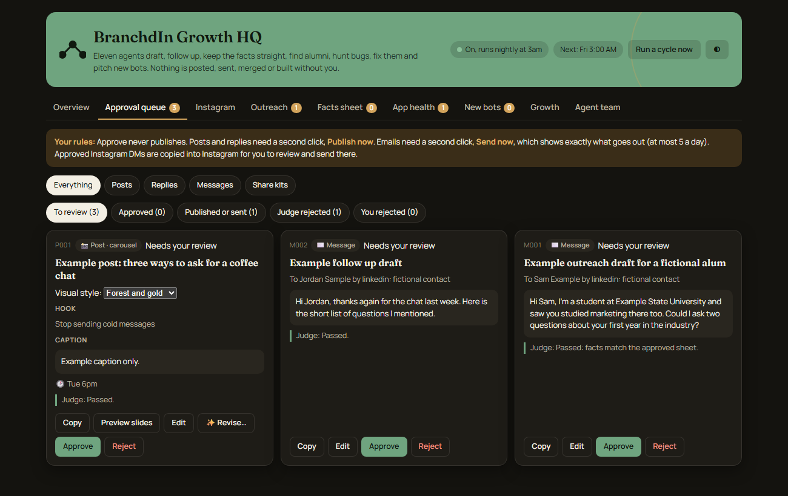

# Alex Reifer: Project Showcase

I'm a determined, hardworking, and curious builder with experience as a wealth management intern. I enjoy learning new skills, solving problems, and turning ideas into useful apps and tools. I'm looking for an internship where I can learn from others, take on challenges, and contribute meaningful value. Through my projects, I want to show my initiative and willingness to keep improving.

I'm interested in work that connects finance, technology, data, and building useful products.

**How to read this page.** My application source code is private, so each project has a written case study with what I built, what works today, the tradeoffs, and what I'm still improving. I build with AI coding tools (Claude Code and others). I set the direction, make the product decisions, connect the pieces, test, and review. I can explain every project here in an interview.

---

## RegimeShield
*A portfolio analytics web app that is honest about old, missing, and simulated data.*

Python and FastAPI backend, plain HTML, CSS, and JavaScript frontend. Revocable account sessions, readiness checks, encrypted backups, and keyboard accessibility work, all checked and dated. Its companion, **Improvement HQ**, is a private dashboard I built to track tasks, ownership, and test evidence.

Result you can verify: 214 local tests passed and a live release check was recorded on October 22, 2026.
[Read the case study](projects/regimeshield.md)

## Personal Workflow Automation Suite
*Small tools that handle repeat chores in my school and job search life, built with Claude Code.*

A morning briefing, an email to calendar triage task, a nightly file organizer for Downloads and Google Drive, a research assistant for a long project, and a notes wiki. Each tool's permissions and safeguards are spelled out, including which ones move files or write to my calendar, and each has a status based on what its recent runs actually produced. One known issue (Telegram is blocked from the cloud environment) is listed openly. 33 briefing pages were generated between September 8 and October 22, 2026.

*Illustrative mockup with fictional data.*

[Read the case study](projects/workflow-automation.md)

## BranchdIn
*A live alumni networking site for college students.*

Next.js and Supabase. Students sign in with a school email and alumni with LinkedIn, and the database enforces that verified students use their school's email. Live at [branchdin.com](https://www.branchdin.com). The page separates what I have verified working from what is built but not yet proven live.
[Read the case study](projects/branchdin.md)

### BranchdIn Growth HQ
*The private dashboard and AI helper team behind BranchdIn.*

A nightly team of narrow agents tracks bugs, keeps facts straight, and drafts outreach. Everything important waits in an approval queue for my yes.

[Read the case study](projects/branchdin-growth-hq.md)

## Trading Research Lab
*Testing trading ideas against buy and hold before trusting them.*

Python backtests and paper trading only, with a test that keeps brokerage code out. Most ideas I tried did not clearly beat holding the S&P 500 ETF, and the write up says so. Two tests currently fail and are disclosed on the page; this is research code, not a finished or production ready product.
[Read the case study](projects/trading-research.md)

---

## Contact
Contact details are intentionally blank for now.
