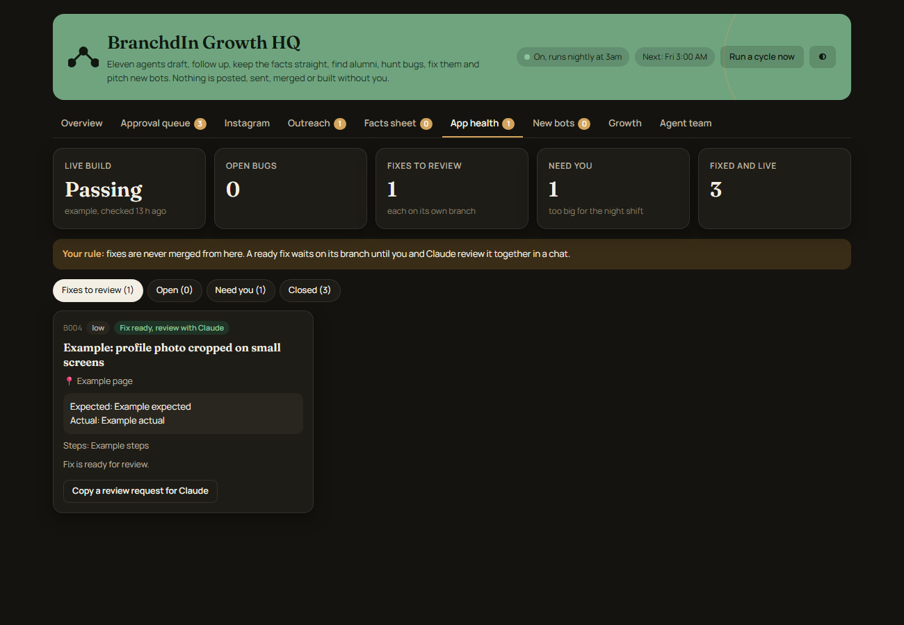

# BranchdIn Growth HQ

**A private dashboard and team of AI helper agents that run the behind the scenes work for BranchdIn, with me approving everything that matters.**

This is the companion tool to [BranchdIn](branchdin.md). It runs on my own computer, and the source is private.

## The problem
Running a young product alone means a lot of side work: tracking bugs, keeping facts straight, drafting outreach, and remembering what was decided. I wanted that work organized and moving every night without giving up control.

## What I built
- A local web dashboard (Growth HQ) with tabs for the work queue, the bug list, proposals, and outreach.
- A nightly loop that runs a team of specialist agents, each with its own written job description and limited tools. Examples: a bug tracker, a fact keeper that holds one approved set of facts about the product, and a kit maker that prepares materials.
- An approval queue. Drafts such as outreach messages wait there until I click Approve. Sending email stays locked until I set it up on purpose.
- A bug tracker where each fix is checked before its status changes. Fourteen of the bugs I logged are marked merged, and a few newer ones are still open or waiting for review.
- Proposals for new helpers, so I decide what gets built next.
- A shared handoff file so different AI tools (Claude Code and Codex) check who is working on what before they edit, and leave notes with files changed and checks run.

## Screenshots (real interface, fictional data)
These are the actual dashboard screens running on invented example data in a separate copy. The names, drafts, and bugs are made up.

## How I stay in control
- Nothing is pushed, sent, or posted without my yes.
- Secrets stay in a local file that is never printed or shared. Runtime data is kept out of Git.
- Database changes happen only after a backup and a dry run.
- A "judge" step checks agent suggestions before they reach me.
- Agents that review the site are read only.

## At a glance
- **My contribution:** designed the approval rules and the team structure, decide what each helper may do, and review everything it drafts. The code was written with AI coding tools.
- **Key decision:** every outward action (send, post, merge, deploy) needs my explicit yes.
- **Verified example:** the bug list records 14 fixes that were checked before being marked merged.
- **What I learned:** guardrails and records matter more than how clever the agents are.

## Decisions and tradeoffs
- Local first: I chose a dashboard on my own computer over a hosted admin site, which keeps private data off the public internet.
- Small agents with narrow jobs are easier to review than one agent that does everything.
- Coordination through a plain handoff file is simple, but it is not live chat, so I relay urgent questions myself.

## What works today
Automated tests for the dashboard code pass (8 tests on October 22, 2026), and the dashboard and nightly loop run on my machine. I am not claiming results like users gained or hours saved.

## What I learned and am improving
Good automation is mostly guardrails: clear jobs, approvals, and records of who did what. Next, a read only agent that reviews the first visit experience of the site, built only after I approve its plan.

The real dashboard shows real people and drafts, so it is not shown here.
