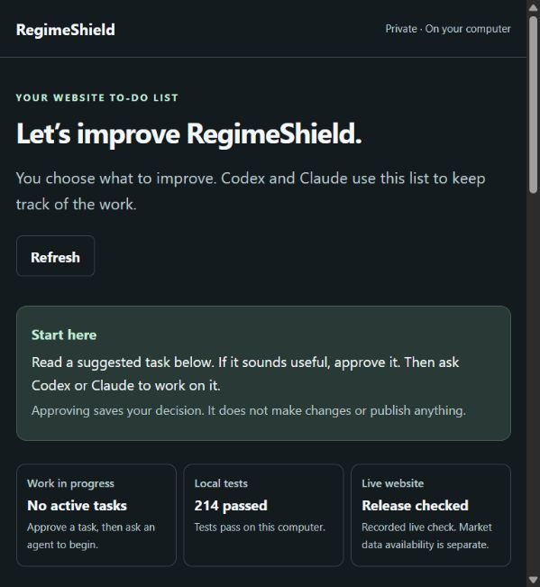

# RegimeShield

**A portfolio analytics web app, with a separate internal dashboard for tracking improvements.**

RegimeShield explores how to make portfolio analysis easier to understand while making data limits, account access, and operational reliability visible to the person using it.

## What I built

- A Python and FastAPI backend with a browser interface in plain HTML, CSS, and JavaScript.
- Educational analysis screens: research, portfolio health check, crash test, tax plan, action plan, and performance.
- Account access improvements: server side sessions that can be revoked, expire, and are tied to one owner, plus account deletion handling and request protections for stored portfolios. I describe this as security improvements and regression testing, not as a security audit.
- Clear labels for stale, unavailable, and simulated data, including simulated historical factor inputs.
- Keyboard support for navigation and dialogs: visible focus, Escape to close, focus kept inside open dialogs, and focus restored afterward.
- Real service readiness checks, release identification, privacy preserving provider observations, and encrypted backups.
- Improvement HQ, a private companion dashboard (see below).

## At a glance
- **My contribution:** product direction, reviewing and testing the work, deciding what counts as fixed, and running release checks. The code was written with AI coding tools, and I built Improvement HQ to keep that work honest.
- **Key decision:** show data limits on screen (stale, unavailable, simulated) instead of hiding them behind confident numbers.
- **Verified example:** the October 22, 2026 release check confirmed the served code version and that anonymous requests to saved portfolios are rejected.
- **What I learned:** a health check that always says "healthy" is worse than none, and verification needs dates.

## Engineering decisions

| Challenge | Approach |
| --- | --- |
| Saved portfolio access | Server side sessions with per account ownership checks, expiry, and revocation. |
| Misleading freshness | Separate the date of a market observation from the time it was fetched. Label missing and older data. |
| Assumed service health | Check runtime libraries, storage access, and disk headroom instead of always answering "healthy". |
| Visibility without exposing users | Keep only outcome counts and timestamps, never holdings, account values, or raw provider responses. |
| Coordinating work | Track ownership, staged task progress, test results, and dated release checks in a separate internal tool. |
| Recoverability | Encrypt snapshots before copying offsite. Check copies and test restores using synthetic data only. |

## Verification (release checked October 22, 2026)

- 214 local automated tests passed.
- 80 focused tests passed on an isolated copy of the release on the server. One Windows specific test was skipped there.
- Public HTTPS checks confirmed the expected code version and that anonymous requests to protected portfolio routes are rejected.
- Internal dashboard routes were not reachable through the public app.
- Keyboard behavior was checked in a browser using synthetic data.
- An encrypted offsite backup copy was authenticated. Restore and tamper checks passed on synthetic data. No real production restore has been performed.

These are dated checks. They are not a claim of uptime, security certification, test coverage, or investment results.

## Improvement HQ (companion internal tool)

A local, private dashboard for the RegimeShield work: a ranked to do list, who owns each task, staged progress, test receipts, and dated release evidence. It separates "unknown", "stale", "tested locally", and "checked live", so nothing is called done or healthy without evidence. The main screen was simplified to a short task list with technical details collapsed.



The screenshot shows the internal work list only. It contains no investor data and no administrative service.

## How the pieces fit

```
Browser  ->  RegimeShield app  ->  analytics and storage
                 
Private operational tools (kept separate, not public)
```

## Current limits

- The historical factor snapshot is still simulated and out of date, with warnings shown. A reviewed real data replacement is not finished.
- Mocked tests and basic readiness checks do not prove that live market data providers are available.
- Offsite backup copying depends on the chosen computer being on.
- Analytics are educational, rest on stated assumptions, and are not personal financial advice.

## Source and process

The application source is in a private repository. This page shares the product, the engineering approach, and selected dated results.

I built it with AI coding tools, and I set the product direction, reviewed the work, ran the tests, and made the release decisions. I can walk through the design and its tradeoffs in an interview.

Technology: Python, FastAPI, NumPy, pandas, SciPy, HTML, CSS, JavaScript, pytest, Linux services, authenticated encryption.
