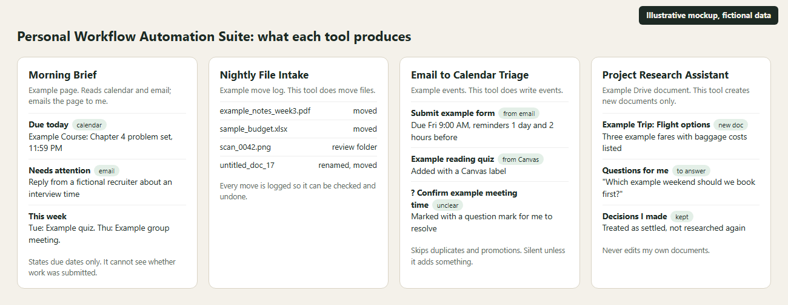

# Personal Workflow Automation Suite

**Small tools that handle repeat chores around school and my internship search, built with Claude Code.**

I kept doing the same tasks by hand: checking what is due, turning emails into reminders, digging through a messy Downloads folder, researching for a trip, and losing track of what I had read. So I built a tool for each. They share a pattern (scheduled runs, written rules, a record of what they did), which is why they sit on one page, but each solves its own problem.

*Illustrative mockup with fictional data. It shows the kind of output, not real emails, files, or events.*

## Status at a glance (checked October 22, 2026)

A run marked "succeeded" does not prove the tool did its job, so each status below rests on what the run actually produced.

| Tool | Status | Evidence |
| --- | --- | --- |
| Morning Brief | Working, verified | 33 briefing pages saved between September 8 and October 22, 2026 |
| Email to Calendar Triage | Working, verified | The October 22 run log shows it created three calendar events and sent one notification. Runs started each morning from October 13 to 22. |
| Project Research Assistant | Working, verified (research docs only) | The October 21 run saved a new research document to Drive and I confirmed it read back. Its Telegram message did not send. |
| Nightly File Intake | Working, verified | Its last run time is recorded for October 22, and the move log has about 790 entries from the October 22 reorganization |
| Notes Wiki (knowledge organization) | Working, verified | Dated ingest and lint entries in its log on October 22, 2026 |
| Coursework Library | Working | A skill that files class material into one folder per class |
| Telegram message intake and delivery | **Configured, not working right now** | The October 22 night run could not reach Telegram. It was blocked by the cloud environment's network settings. The run still reported "succeeded", and no calendar events were created. |
| Earlier reminder and content routines | Paused | Not featured |

## The tools

### 1. Morning Brief
- **Repeat work:** checking calendars and inbox each morning to see what is due and what matters.
- **How it works:** a scheduled Claude Code task reads Google Calendar (including a read only Canvas assignment feed) and Gmail, renders one web page, and emails it to me.
- **Permissions:** it reads. It is told not to reply to anyone or create or change calendar events. Its only outputs are the page and the email to myself.
- **Safeguards:** text in emails and events is treated as data, never as instructions. It reports due dates only and never says an assignment is unsubmitted, because it cannot see submission status.

### 2. Email to Calendar Triage (separate from the Morning Brief)
- **Repeat work:** turning deadlines and requests buried in email into reminders I will actually see.
- **How it works:** a scheduled cloud routine runs each morning before the brief. It scans the last day of Gmail and the next two weeks of the Canvas calendar, then creates calendar events with reminders one day and two hours ahead.
- **Permissions:** this tool does write to my calendar, without a click for each event. It reads Gmail and does not send or reply to email.
- **Safeguards:** it first reads the existing calendar and skips duplicates, ignores marketing and automated mail, marks unclear items with a question mark so I can resolve them, labels Canvas items, and stays silent unless it added something. It is told never to invent an action item.

### 3. Nightly File Intake
- **Repeat work:** sorting new Downloads and Google Drive files into folders by class, year, and topic.
- **How it works:** a scheduled task moves new files using a written folder map and, for notable files, writes a one line pointer to a notes file.
- **Permissions:** this tool does move files, so it is not read only. It can move and rename files and create folders.
- **Safeguards:** folders it must never touch, a rule never to write anything that could be turned in for a grade, a record of each move, unclear files sent to a review folder, and silence unless something fails.

### 4. Project Research Assistant
- **Repeat work:** keeping a long personal project moving between my own sessions.
- **How it works:** a scheduled routine runs twice a week. It reads a project brief and a questions and decisions document that I keep in Google Drive, researches one topic, and saves a new document ending in questions for me. A separate weekly sync carries my answers between a planner page and the Drive folder.
- **Permissions:** it creates new Drive documents and does not edit my own.
- **Safeguards:** my decisions are treated as settled and are not re researched, and standing rules I set (like always listing baggage costs) are applied to every flight it looks at.

### 5. Notes Wiki and Coursework Library (knowledge organization)
- **Repeat work:** notes and readings that never connect to each other.
- **How it works:** Claude Code writes linked Obsidian pages from my class material and project notes under a written schema, and a nightly scan looks for new material. A separate skill files class material into one folder per class.
- **Safeguards:** original sources are never edited, claims must trace to a source, unclear items are logged for me instead of guessed, and the notes keep a record of each lint check. The vault holds personal data, so it is not published.

## Known issue I'm working on
Telegram is blocked from the cloud environment these routines run in. That stops the Telegram based task intake and the Telegram summaries. The research and calendar work does not depend on it, and some routines fall back to a phone notification. I will list Telegram as working only after a run confirms it.

## At a glance
- **My contribution:** I spotted the repeat chores, wrote each tool's instructions and rules, connected Gmail, Calendar, Drive, and Obsidian, and review the results. Claude Code does the day to day work inside those rules.
- **Key decision:** keep the Morning Brief read only and give calendar writing to a separate, narrower tool, so each tool has one clear permission level.
- **Verified example:** the October 22, 2026 Email to Calendar run created three events, matching its logged report.
- **What I learned:** verify the output, not the status.

## What I'm not claiming
No time savings figure, no reliability rate, and no claim that these run fully on their own. I check and fix them.

## What I learned and am improving
A "succeeded" status can hide a task that did nothing, so I verify outputs. Writing down what a tool must never do matters as much as what it does.
